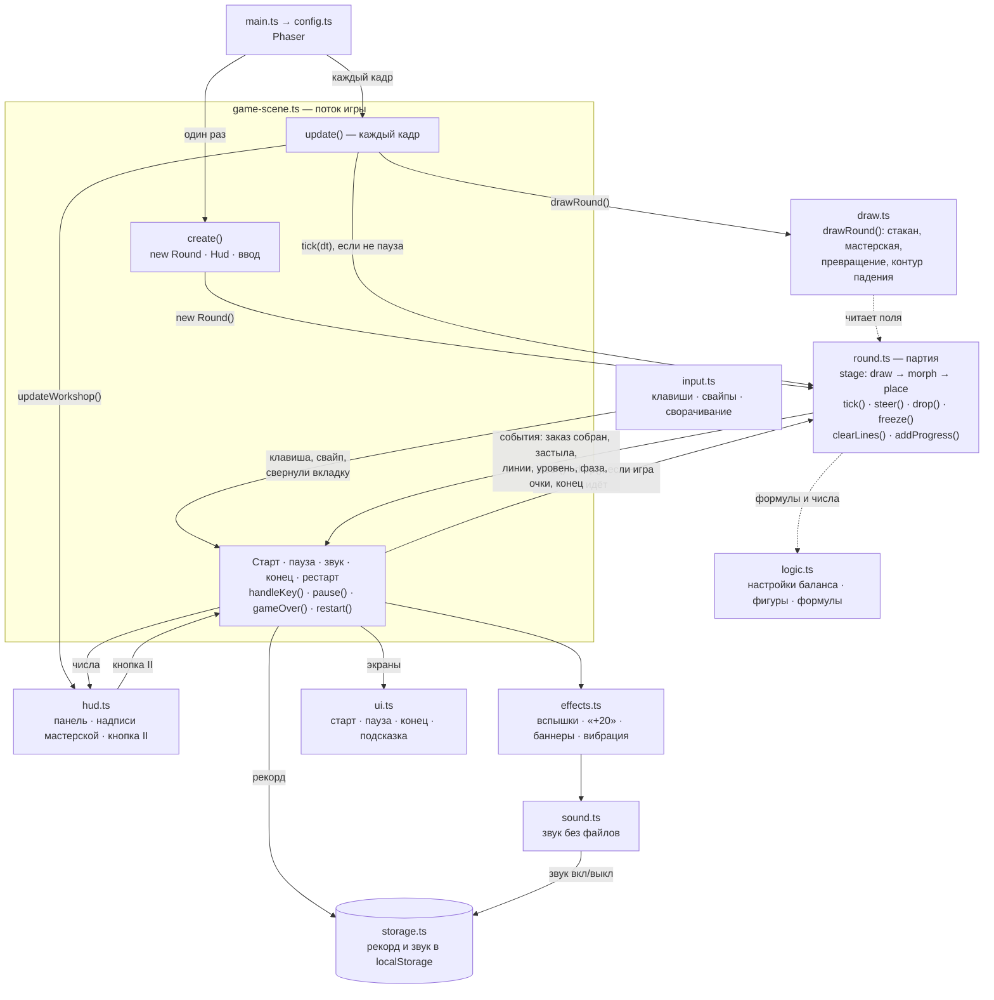
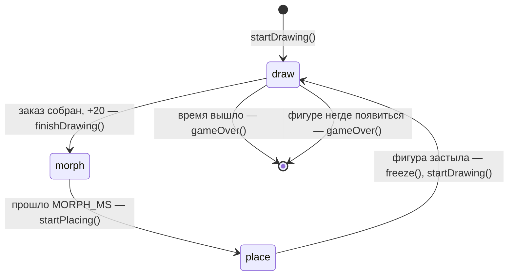

# Архитектура Змейтриса — как есть

Сцена Phaser [`GameScene`](./src/game/game-scene.ts) связывает части игры и ведёт её поток: старт → игра ⇄ пауза → конец → «Ещё раз». Сама партия со всеми правилами — в [`round.ts`](./src/game/round.ts), без Phaser. Остальное разложено по файлам: ввод, панель, эффекты, звук, рисование, экраны, хранилище.

## Схема

Сплошная стрелка — вызывает или меняет состояние. Пунктир — только читает. Схему рисует GitHub прямо в этом файле.

## Этапы одной фигуры

- **draw** — мастерская 5 × 5. Клетки `snake` и камни `rocks` (фаза 3) — в координатах мастерской. Идёт таймер `drawMsLeft`, стакан стоит. Правило шага змейки — `canStep()` / `stepSnake()` в `logic.ts`: им же пользуется `canBuild()`, когда проверяет, что при расставленных камнях заказ можно собрать.
- **morph** — переход на `MORPH_MS`: `draw.ts` рисует превращение по `morphMs`, ввод не действует, стакан стоит.
- **place** — клетки `snake` — в координатах стакана. Гравитация, сдвиг, поворот, бросок, пауза на опоре.

## Где что живёт

| Что | Файл | Где именно |
|---|---|---|
| Ввод | `input.ts` → `game-scene.ts` → `round.ts` | `setupInput()` переводит клавиши в намерения (`KeyIntent`), движение пальца — в направления, сворачивание вкладки — в событие. Что с этим делать, решают `handleKey()`, `handleDir()`, `handleTap()` в сцене. Стрелки уходят в `Round.steer()`: в мастерской шагает голова, в стакане двигается или крутится фигура. Кнопка «II» — `hud.ts` |
| Состояние игры | `round.ts` + `game-scene.ts` | партия — поля `Round`: `stage`, `grid`, `snake`, `rocks`, `orders`, `score`, `lines`, `level`, `phase`, таймеры `drawMsLeft`, `morphMs`, `fallTimer`, `restMs`, флаг `isOver`. Сцена — `isStarted`, `isPaused`, `canRestart`, `bestScore`. Очки, линии, уровень и фазу меняет только `addProgress()` |
| Результат — конец игры | `round.ts` → `game-scene.ts` | `Round.gameOver()` зовут `tickDrawing()` («Время вышло!») и `finishDrawing()` («Стакан полон!»). Партия сообщает событием `onGameOver`, а `gameOver()` в сцене сохраняет рекорд (`storage.ts`), включает тряску и звук (`effects.ts`) и показывает карточку (`ui.ts`) |
| Перезапуск | `game-scene.ts` | `restart()` → `scene.restart({ skipIntro: true })` → `create()`: новая партия `new Round()` и сброс флагов сцены |
| Сложность, появление, правила | `logic.ts` + `round.ts` | настройки в начале `logic.ts`: скорость падения, время на заказ, мастерская, линии на уровень, очки, длительность превращения, пороги и параметры фаз (в фазе 3 — `workshopRocks`). Формулы — `fallMsForLevel()`, `drawMsForLevel()`, `levelForLines()`, `scoreForLines()`, `phaseForScore()`, `phaseParams()`. Фигуры и их узнавание — `SHAPES`, `shapeOf()`; поворот — `rotateAround()`. Появление фигуры — `pieceAtTop()` в `round.ts` и `spawnLeft()` |

## Время

- **Игровое время** — всё, что считается в `Round.tick(dt)`: таймер заказа (`drawMsLeft`), превращение (`morphMs`), падение фигуры (`fallTimer`), пауза перед застыванием (`restMs`). Сцена не вызывает `tick()` на паузе, на стартовом экране и после конца игры — поэтому на паузе стоят и таймер, и превращение.
- **Время браузера** — только украшения: анимации из `ui.ts` и `effects.ts`, мигание красного верха стакана (`this.time.now` в `drawRound()`), задержка перед карточкой конца игры (`this.time.delayedCall`).

## Замечания

- `game-scene.ts` только связывает части. Правила партии живут в `round.ts` без Phaser — их можно менять и проверять отдельно от картинки.
- Одно поле `snake` на этапах `draw` и `morph` хранит клетки в координатах мастерской, а на этапе `place` — в координатах стакана. `draw.ts` выбирает, как их рисовать, по `stage`.
- Поля `Round` открыты для чтения: их читают `draw.ts` и `hud.ts`. Менять их должны только методы `Round` — это договорённость, TypeScript её не проверяет.
- Очки, линии, уровень и фаза меняются только в `addProgress()`. Это окупилось: очки за собранный заказ добавились одним вызовом, а уровень и фаза обновляются сами.
- Состояние «старт / игра / пауза / конец» по-прежнему хранится флагами: `isStarted` и `isPaused` у сцены, `isOver` у партии.
