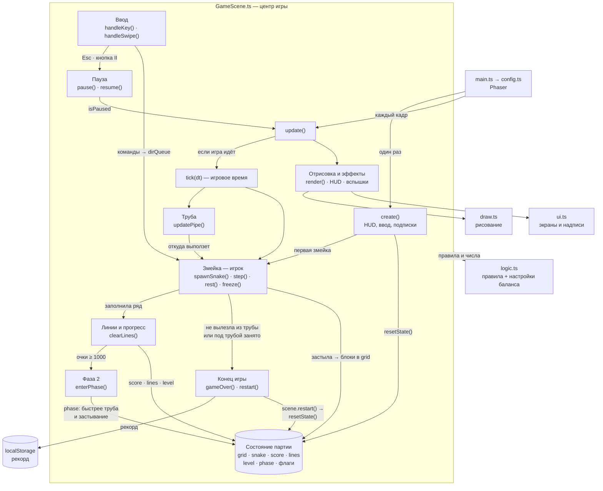

# Архитектура Змейтриса — как есть

Одна сцена Phaser [`GameScene`](./src/game/GameScene.ts) — центр игры: в ней состояние партии, ввод, игровой цикл и связь всего вместе. Правила и настройки баланса вынесены в [`logic.ts`](./src/game/logic.ts) (без Phaser), рисование — в [`draw.ts`](./src/game/draw.ts), экраны и надписи — в [`ui.ts`](./src/game/ui.ts).

## Схема

Сплошная стрелка — вызывает или меняет состояние. Пунктир — берёт правила и числа из `logic.ts`. Схему рисует GitHub прямо в этом файле.

## Где что живёт

| Что | Файл | Где именно |
|---|---|---|
| Ввод | `GameScene.ts` | `setupKeyboard()` → `handleKey()`, `setupPointer()` → `handleSwipe()`; обе ведут в `queueDir()`. ↓ во время падения — `pressDownWhileFalling()`. Esc и кнопка «II» — `togglePause()` / `pause()`, сворачивание вкладки — `setupAutoPause()` |
| Состояние игры | `GameScene.ts` | поля класса: `grid`, `snake`, `dir`, `dirQueue`, `score`, `lines`, `level`, `phase`, таймеры `stepTimer`, `pipeTimer`, `restMs`, флаги `isStarted`, `isPaused`, `isGameOver` |
| Результат — конец игры | `GameScene.ts` | `gameOver()`: зовут `freeze()` (змейка застыла, не выбравшись из трубы) и `spawnSnake()` (под трубой занято). Рекорд — `saveBestScore()`, карточка — `showGameOverCard()` в `ui.ts` |
| Перезапуск | `GameScene.ts` | `restart()` → `scene.restart({ skipIntro: true })` → `create()` → `resetState()` сбрасывает всё состояние партии |
| Сложность, появление, правила | `logic.ts` | настройки в начале файла: длина и скорость змейки, линии на уровень, очки, порог и параметры фаз. Формулы — `snakeLengthForLevel()`, `stepMsForLevel()`, `levelForLines()`, `scoreForLines()`, `phaseForScore()`, `phaseParams()`. Появление змейки — `spawnSnake()` и `updatePipe()` в `GameScene.ts` |

## Время

- **Игровое время** — всё, что считается в `tick(dt)`: шаги змейки (`stepTimer`), движение трубы (`pipeTimer`), пауза перед застыванием (`restMs`). На паузе, на стартовом экране и после конца игры `tick()` не вызывается.
- **Время браузера** — только украшения: анимации из `ui.ts` и вспышки, мигание красной трубы (`this.time.now`), задержка перед карточкой конца игры (`this.time.delayedCall`).

## Замечания

- `GameScene.ts` — самая нагруженная часть (около 800 строк): состояние, ввод, правила шага, прогресс, эффекты и верхняя панель в одном классе. Почти любое новое правило меняет этот файл.
- Состояние «старт / игра / пауза / конец» хранится в трёх отдельных флагах, и каждую проверку пишут вручную в нескольких методах.
- Очки, уровень и фаза обновляются внутри `clearLines()`: если очки начнут начисляться где-то ещё, фазу и уровень легко забыть обновить.
