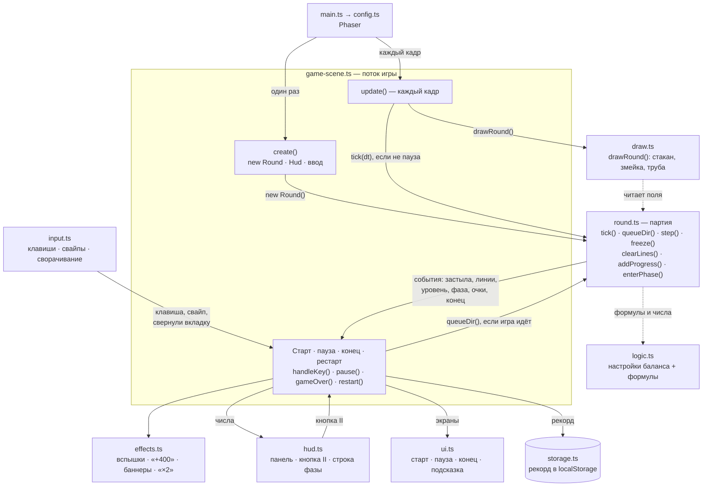

# Архитектура Змейтриса — как есть

Сцена Phaser [`GameScene`](./src/game/game-scene.ts) связывает части игры и ведёт её поток: старт → игра ⇄ пауза → конец → «Ещё раз». Сама партия со всеми правилами — в [`round.ts`](./src/game/round.ts), без Phaser. Остальное разложено по файлам: ввод, панель, эффекты, рисование, экраны, рекорд.

## Схема

Сплошная стрелка — вызывает или меняет состояние. Пунктир — только читает. Схему рисует GitHub прямо в этом файле.

## Где что живёт

| Что | Файл | Где именно |
|---|---|---|
| Ввод | `input.ts` → `game-scene.ts` → `round.ts` | `setupInput()` переводит клавиши в намерения (`KeyIntent`), движение пальца — в направления, сворачивание вкладки — в событие. Что с этим делать, решают `handleKey()` и `handleDir()` в сцене. Буфер команд и ↓ во время падения — `queueDir()` в `round.ts`. Кнопка «II» — `hud.ts` |
| Состояние игры | `round.ts` + `game-scene.ts` | партия — поля `Round`: `grid`, `snake`, `dir`, `dirQueue`, `score`, `lines`, `level`, `phase`, таймеры `stepTimer`, `pipeTimer`, `restMs`, флаг `isOver`. Сцена — `isStarted`, `isPaused`, `canRestart`, `bestScore`. Очки, линии, уровень и фазу меняет только `addProgress()` |
| Результат — конец игры | `round.ts` → `game-scene.ts` | `Round.gameOver()` зовут `freeze()` (змейка застыла, не выбравшись из трубы) и `spawnSnake()` (под трубой занято). Партия сообщает событием `onGameOver`, а `gameOver()` в сцене сохраняет рекорд (`storage.ts`), трясёт экран (`effects.ts`) и показывает карточку (`ui.ts`) |
| Перезапуск | `game-scene.ts` | `restart()` → `scene.restart({ skipIntro: true })` → `create()`: новая партия `new Round()` и сброс флагов сцены |
| Сложность, появление, правила | `logic.ts` + `round.ts` | настройки в начале `logic.ts`: длина и скорость змейки, линии на уровень, очки, порог и параметры фаз. Формулы — `snakeLengthForLevel()`, `stepMsForLevel()`, `levelForLines()`, `scoreForLines()`, `phaseForScore()`, `phaseParams()`. Появление змейки — `spawnSnake()` и `updatePipe()` в `round.ts` |

## Время

- **Игровое время** — всё, что считается в `Round.tick(dt)`: шаги змейки (`stepTimer`), движение трубы (`pipeTimer`), пауза перед застыванием (`restMs`). Сцена не вызывает `tick()` на паузе, на стартовом экране и после конца игры.
- **Время браузера** — только украшения: анимации из `ui.ts` и `effects.ts`, мигание красной трубы (`this.time.now` в `drawRound()`), задержка перед карточкой конца игры (`this.time.delayedCall`).

## Замечания

- `game-scene.ts` (около 180 строк) только связывает части. Правила партии живут в `round.ts` без Phaser — их можно менять и проверять отдельно от картинки.
- Состояние «старт / игра / пауза / конец» по-прежнему хранится флагами: `isStarted` и `isPaused` у сцены, `isOver` у партии.
- Поля `Round` открыты для чтения: их читают `draw.ts`, `hud.ts` и значок «×2». Менять их должны только методы `Round` — это договорённость, TypeScript её не проверяет.
- Очки, линии, уровень и фаза меняются только в `addProgress()`, поэтому новый источник очков (например, бонус) сам двинет уровень и фазу.
